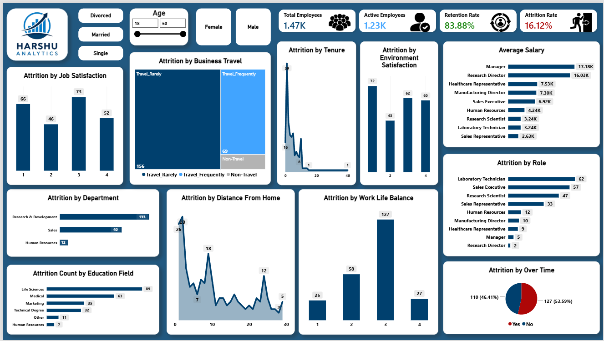

# 👥 Workforce Attrition & Retention Analytics (Power BI, SQL & DAX)

### 📌 Project Overview
Architected a diagnostic HR analytics interface in Power BI to evaluate employee turnover drivers, compensation bands, overtime burnout patterns, and department-level retention metrics. Backed by custom backend SQL querying to extract and structure raw employee datasets.

---

### 🖼️ Dashboard Preview

---

### ⚙️ Technical Architecture & Workflow
* **SQL Database Extraction:** Queried relational employee datasets using custom SQL scripts (`HR Employee Attrition.sql`) to pull clean base records, handle constraints, and structure tables for BI ingestion.
* **Power Query (ETL):** Cleaned and transformed raw HR records further within Power Query, creating standardized age brackets, tenure bands, and salary tiers.
* **Data Modeling:** Structured relational tables linking employee demographics, job roles, and attrition outcomes.
* **Explicit DAX Measures:** Built custom DAX measures for Total Headcount, Active Employees, Attrition Count, and Attrition Rate % (`DIVIDE`, `CALCULATE`).
* **Interactive UI/UX:** Implemented demographic slicers, conditional formatting rules, and horizontal breakdown charts to isolate high-risk roles.

---

### 📂 Repository Files
* `Workforce_Attrition_Dashboard.pbix` – Full Power BI Desktop report
* `dashboard_overview.png` – High-resolution dashboard UI snapshot
* `HR Employee Attrition.sql` – Backend SQL extraction and query script
* `HR Employee Attrition.csv` – Source HR dataset
